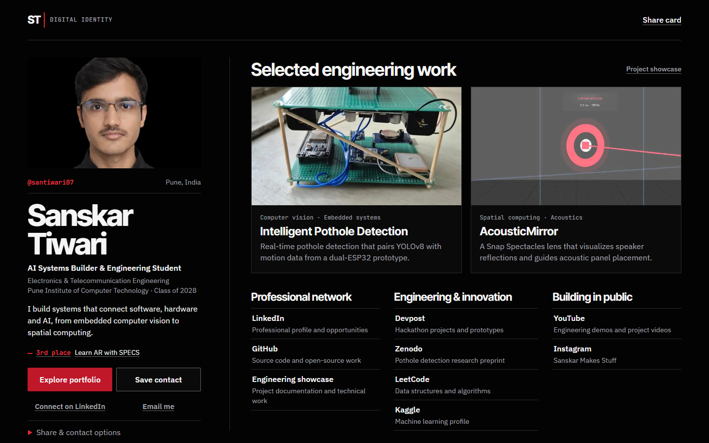

# Sanskar Tiwari — Digital Identity

A mobile-first digital visiting card for NFC taps, QR scans and direct links. It presents Sanskar’s engineering identity, two selected projects, professional profiles and quick contact actions.

The production candidate is `https://santiwari07.qzz.io/card`. The public URL currently serves the portfolio fallback. Preview the new card locally before integrating it with the portfolio.

## Run locally

Use Node.js 22 or later.

```sh
npm ci
npm run dev
```

Open [the local card](http://127.0.0.1:4743/card). If the port is in use, set `CARD_PREVIEW_PORT` to a free port and open the address printed by the preview server. Run `npm run build` for the static files in `dist/`.

## What visitors can do

- Explore the portfolio, selected project documentation and professional profiles.
- Save a vCard or open their email app. Copy the email address from the share panel.
- Share through the device share sheet where available, copy the card URL, or download the QR as PNG or SVG.

Profile text, links, contact details and the canonical URL are maintained in `profile.mjs`. The build renders static HTML and generates the vCard and both QR formats. Essential links, downloads and manual copying work with JavaScript disabled.

## Browser screenshots

| Phone · 390 × 844 | Desktop · 1440 × 900 |
| --- | --- |
|  |  |

[Share panel on a phone](screenshots/sharing-phone.png) · [Full-page screenshots](screenshots/viewports/) · [Responsive test report](RESPONSIVE_TEST_REPORT.md)

## Documentation

| Document | Coverage |
| --- | --- |
| [Research](RESEARCH.md) | Thirteen examples, standards and hosting options |
| [Design system](DESIGN_SYSTEM.md) | Three concepts, selected direction and visual rules |
| [Project specification](PROJECT_SPECIFICATION.md) | Source audit, verified content and implementation architecture |
| [NFC setup](NFC_SETUP.md) | Identify, write, read back and test an NDEF URI record |
| [Test report](TEST_REPORT.md) | Functional, performance and accessibility results |
| [Deployment](DEPLOYMENT.md) | Local build, Vercel configuration and portfolio integration |
| [Maintenance](MAINTENANCE.md) | Content, asset and canonical URL updates |

Physical Android and iPhone NFC, native share sheets and Contacts import are pending. Keep the tag writable until the approved production page has been verified end to end.
