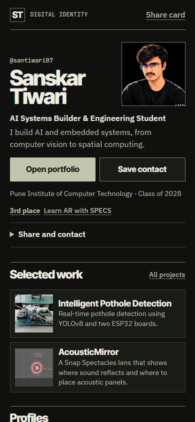

# CrimsonID

Static NFC visiting card and digital identity page for Sanskar Tiwari, built with a racing-red editorial cover, direct contact and portfolio actions, an inline QR code, and a categorized profile directory.

Production target: `https://santiwari07.qzz.io/card`

## Overview

CrimsonID compiles a single profile module into a zero-framework static site (`dist/card/index.html`) along with self-hosted fonts, brand icons, a downloadable UTF-8 vCard (`sanskar-tiwari.vcf`), and SVG/PNG QR codes generated from the canonical URL.

Core visitor actions:

- **Explore my work**: Opens the primary portfolio (`https://santiwari07.qzz.io/`).
- **Save contact**: Downloads `sanskar-tiwari.vcf` (vCard 3.0) for direct import into Contacts.
- **View projects**: Links to the engineering showcase (`https://santiwari07.github.io/`).
- **Email me**: Opens the default mail client via `mailto:`.
- **Scan QR**: Scrolls directly to the inline QR code (`#profile-qr`) for camera-to-phone sharing.
- **Profile directory**: Groups links across **The Network** (LinkedIn, GitHub), **Proof of Work** (Devpost, Zenodo, LeetCode, Kaggle), and **Building in Public** (YouTube, Instagram).

All links, contact downloads, and the inline QR work without JavaScript. Client-side JS (`assets/card.js`) is limited to hiding broken portrait images if loading fails.

## Preview

| Mobile (390 x 844) | Desktop (1440 x 900) |
| --- | --- |
|  |  |

Full mobile scroll view: [screenshots/editorial-mobile.png](screenshots/editorial-mobile.png)

## Local development

Requires **Node.js 22** or later.

```sh
npm ci
npm run dev
```

Open `http://127.0.0.1:4743/card` in your browser. If port `4743` is busy, set `CARD_PREVIEW_PORT`:

```sh
CARD_PREVIEW_PORT=8080 npm run dev
```

To generate the production static bundle in `dist/` without starting the preview server:

```sh
npm run build
```

## Repository structure

```text
.
├── assets/                 # Stylesheet, minimal JS, favicon, fonts, images, and brand logos
├── docs/                   # Design system, research, specifications, NFC setup, and reports
├── reports/                # Lighthouse mobile audit outputs (HTML and JSON)
├── screenshots/            # Reference captures and responsive viewport matrix
├── scripts/
│   ├── build.mjs           # Generates dist/card/ and dist/card-assets/
│   └── preview.mjs         # Local static preview server with vCard download headers
├── src/
│   ├── integrations.mjs    # Generates vCard 3.0 (.vcf) and QR codes (.svg, .png)
│   ├── profile.mjs         # Single source of truth for bio, URLs, assets, and links
│   └── render.mjs          # Renders semantic HTML, Open Graph tags, and JSON-LD
├── package.json
└── vercel.json             # Vercel static output, /card rewrite, and vCard headers
```

## Updating profile content

Edit [src/profile.mjs](src/profile.mjs) to update personal details, links, portrait metadata, or the `canonicalUrl`, then run `npm run build` to regenerate the HTML, vCard, and QR assets together. See [docs/MAINTENANCE.md](docs/MAINTENANCE.md) for asset and URL guidelines.

## Documentation

| Document | Coverage |
| --- | --- |
| [Design system](docs/DESIGN_SYSTEM.md) | Visual concepts, color tokens, typography, and layout rules |
| [Project specification](docs/PROJECT_SPECIFICATION.md) | Source audit, verified data, and static architecture |
| [Research](docs/RESEARCH.md) | Reference benchmarks, standards, and hosting options |
| [Deployment](docs/DEPLOYMENT.md) | Local build, Vercel routing, and portfolio integration |
| [Maintenance](docs/MAINTENANCE.md) | Content updates, asset hygiene, and canonical URL safety |
| [NFC setup](docs/NFC_SETUP.md) | Tag inspection, NDEF URI writing, and device verification |
| [Test report](docs/TEST_REPORT.md) | Functional checks, Lighthouse metrics, and accessibility |
| [Responsive test report](docs/RESPONSIVE_TEST_REPORT.md) | 21-viewport Chrome matrix and cross-browser results |
